The Fourier Transform provides a way to represent an image in terms of its frequency components. Just as a number can be represented in different forms such as decimal, binary, or hexadecimal depending on the type of analysis being performed, an image can also be represented in different domains.

The most common representation of an image is the **spatial domain**, where the image is described by its pixel intensities at different spatial locations. The Fourier Transform provides another representation, called the **frequency domain**, where the image is described in terms of its spatial-frequency components.

This representation is useful because different characteristics of an image are associated with different spatial frequencies. Slowly varying regions of an image are mainly associated with low frequencies, while rapid changes such as edges, fine details, and some types of noise are associated with higher frequencies.

In the **Fourier Transform experiment**, you will study how a digital image is represented in the frequency domain, understand the magnitude and phase of its Fourier Transform, observe the relationship between spatial and frequency-domain representations, and study how frequency-domain filtering affects an image.

### Spatial Domain and Frequency Domain

In the **spatial domain**, an image is represented directly by its pixel values. Let $f(x,y)$ represent an image, where $x$ and $y$ denote the spatial coordinates and $f(x,y)$ represents the intensity at that location.

In the **frequency domain**, the same image is represented using its spatial-frequency components. The Fourier Transform converts the spatial-domain image into this frequency-domain representation.

The spatial domain therefore describes **where** intensity values occur, while the frequency domain describes **how rapidly the intensity changes across space**.

A smooth region with gradual changes in intensity mainly contributes to low-frequency components. Sharp transitions, edges, fine details, and rapid variations contribute more strongly to higher-frequency components.

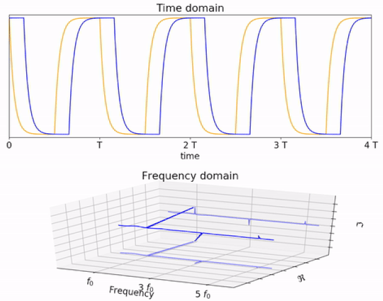

_Figure 1: Conceptual illustration of a signal in the time domain and frequency domain._

The figure illustrates the general idea of representing a signal using its frequency components. A signal that varies with time can be represented in the frequency domain as a combination of different frequencies. The same principle is extended to images, where the intensity varies over two spatial dimensions.

Thus, the Fourier Transform does not change the information contained in the image; it provides a different representation that can be more convenient for certain types of analysis and processing.

### Fourier Transform and Sinusoidal Functions

The Fourier Transform represents an image in terms of a combination of sinusoidal basis functions with different frequencies and orientations.

A sinusoidal pattern that varies slowly across an image corresponds to a low spatial frequency. A pattern that changes rapidly corresponds to a higher spatial frequency.

This provides an intuitive interpretation of the Fourier Transform: a complex image can be considered as a combination of simpler sinusoidal patterns, each contributing a particular spatial-frequency component.

The Fourier Transform determines the strength and phase of these components. By examining these components, we can understand the frequency content of the original image.

For digital images, we use the **Discrete Fourier Transform (DFT)** because the image consists of a finite number of discrete pixel values.

### Two-Dimensional Discrete Fourier Transform

Let $f(m,n)$ represent a digital image of size $M \times N$. Its two-dimensional Discrete Fourier Transform is given by

$$
F(k,l)=
\sum_{m=0}^{M-1}
\sum_{n=0}^{N-1}
f(m,n)
\exp\left[
-j2\pi
\left(
\frac{km}{M}
+
\frac{ln}{N}
\right)
\right]
$$

where:

- $f(m,n)$ is the input image in the spatial domain;
- $F(k,l)$ is the Fourier Transform of the image;
- $m$ and $n$ represent spatial coordinates;
- $k$ and $l$ represent frequency coordinates;
- $M$ and $N$ are the dimensions of the image; and
- $j$ is the imaginary unit, where $j^2=-1$.

The DFT evaluates the contribution of the different discrete spatial-frequency components present in the image.

The inverse Discrete Fourier Transform (IDFT) reconstructs the spatial-domain image from its frequency-domain representation:

$$
f(m,n)=
\frac{1}{MN}
\sum_{k=0}^{M-1}
\sum_{l=0}^{N-1}
F(k,l)
\exp\left[
j2\pi
\left(
\frac{km}{M}
+
\frac{ln}{N}
\right)
\right]
$$

The factor

$$
\frac{1}{MN}
$$

is the normalization factor used in the inverse transformation.

The DFT and IDFT therefore provide two complementary representations of the same image:

$$
f(m,n)
\overset{\mathrm{DFT}}{\longrightarrow}
F(k,l)
\overset{\mathrm{IDFT}}{\longrightarrow}
f(m,n)
$$

The DFT is widely used in image processing applications such as image analysis, filtering, restoration, and compression.

### Frequency Components of an Image

The frequency components of an image describe the rate at which its intensity changes across space.

**Low-frequency components** are associated mainly with slowly varying intensity information. Large smooth regions and gradual changes in brightness contribute strongly to these components.

**High-frequency components** are associated mainly with rapid changes in intensity. Edges, fine details, sharp transitions, and some types of noise contribute strongly to these components.

Therefore, examining the frequency distribution of an image provides another way to understand its visual characteristics.

For example, an image containing large smooth regions will generally have strong low-frequency components, whereas an image containing many sharp edges or fine details will have more significant high-frequency components.

### Fourier Transform of Sinusoidal Patterns

The relationship between a spatial pattern and its frequency representation can be understood more easily using simple sinusoidal images.

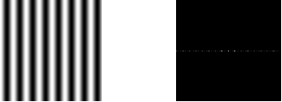

_Figure 2: Horizontal sinusoidal pattern and its Fourier-domain representation._

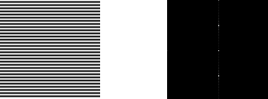

_Figure 3: Vertical sinusoidal pattern and its Fourier-domain representation._

These figures demonstrate that a simple sinusoidal pattern produces prominent frequency components at specific locations in the Fourier spectrum.

The location of these components indicates the spatial frequency and orientation of the sinusoidal pattern. The symmetric components about the centre arise because the input image is real-valued and therefore contains corresponding positive and negative frequency components.

These simple examples provide an intuitive understanding of how specific structures in the spatial domain are represented in the frequency domain.

### Magnitude and Phase of the Fourier Transform

The DFT produces a complex-valued result. Each frequency coefficient can therefore be represented using its real and imaginary components.

The magnitude of a Fourier coefficient is given by

$$
|F(k,l)|=
\sqrt{
\operatorname{Re}(F(k,l))^2+
\operatorname{Im}(F(k,l))^2
}
$$

The magnitude represents the strength of the corresponding frequency component.

The phase is given by

$$
\phi(k,l)=
\operatorname{atan2}
\left(
\operatorname{Im}(F(k,l)),
\operatorname{Re}(F(k,l))
\right)
$$

The phase provides information about the spatial arrangement of the frequency components.

The Fourier Transform of an image can therefore be described using both its **magnitude spectrum** and **phase spectrum**.

In practice, the magnitude spectrum is often displayed because it provides a convenient visual representation of the distribution and strength of the frequency components.

### Fourier Spectrum

For visualization, the Fourier spectrum is commonly shifted so that the zero-frequency component is positioned at the centre of the displayed spectrum.

The zero-frequency component is also called the **DC component** and is given by

$$
F(0,0)
$$

For an image, this component is related to the average intensity of the image.

After shifting the spectrum:

- frequencies near the centre represent lower spatial frequencies;
- frequencies farther from the centre represent higher spatial frequencies; and
- brighter regions indicate stronger frequency components.

The distance from the centre therefore provides an indication of the spatial frequency.

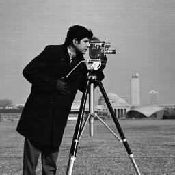

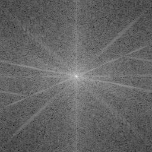

_Figure 4: A spatial-domain image and its corresponding Fourier magnitude spectrum._

The first image represents the original image in the spatial domain. The second image represents the magnitude of its Fourier Transform.

The Fourier spectrum does not resemble the original image because it represents the distribution of spatial frequencies rather than the spatial arrangement of image pixels.

The central bright region corresponds to strong low-frequency components. Components farther from the centre represent progressively higher spatial frequencies.

### Logarithmic Display of the Fourier Spectrum

The magnitude values of a Fourier Transform can have a very large dynamic range. A few frequency components may have very large magnitudes while many other components have much smaller magnitudes.

If the magnitude spectrum is displayed directly, the large values can dominate the display and make weaker components difficult to see.

A logarithmic transformation can therefore be used for visualization:

$$
S(k,l)=\log\left(1+|F(k,l)|\right)
$$

The logarithmic transformation compresses the dynamic range of the magnitude spectrum and makes weaker frequency components more visible.

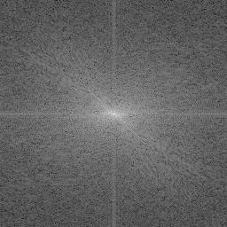

_Figure 5: Logarithmically scaled Fourier magnitude spectrum._

The logarithmically scaled spectrum provides a clearer visual representation of the distribution of frequency components. It allows frequency components with smaller magnitudes to be observed alongside the dominant components.

The spectrum can also reveal directional characteristics of an image. For example, strong structures along particular directions in the spatial image can produce corresponding patterns in the frequency spectrum.

### Phase Spectrum

The phase spectrum represents the phase associated with each frequency component.

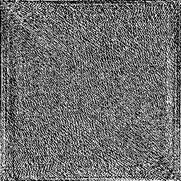

_Figure 6: Phase spectrum of an image._

Each location in the phase spectrum corresponds to a particular frequency component, and its intensity represents the phase associated with that component.

The phase is important for reconstructing the spatial arrangement of image structures. Although the magnitude spectrum describes the strength of the frequency components, the phase contains important information about their spatial organization.

This can be demonstrated by reconstructing an image using the magnitude information while discarding the original phase information.

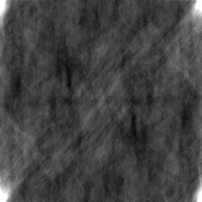

_Figure 7: Reconstruction using magnitude information without the original phase information._

The reconstructed image does not retain the original spatial appearance even though the magnitude information is preserved. This demonstrates that the phase spectrum contains important information about the spatial structure of an image.

Therefore, both magnitude and phase contribute to the representation of an image in the frequency domain.

### Fourier Transform of Natural Images

Natural images generally contain many different spatial structures and therefore contain a wide range of frequency components.

_Figure 8: An image represented in the spatial domain._

The image contains smooth regions, edges, fine details, and other spatial structures. These different structures contribute to different frequency components.

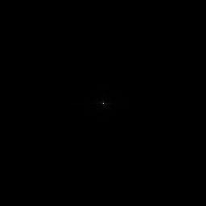

_Figure 9: Magnitude spectrum of a natural image._

The magnitude spectrum of a natural image usually contains a strong concentration of low-frequency components near the centre, along with higher-frequency components farther from the centre.

The exact appearance of the spectrum depends on the structures present in the image. Edges, fine details, repetitive patterns, and their orientations influence the distribution of the frequency components.

Thus, the Fourier spectrum provides a useful way of examining the frequency characteristics of an image.

### Frequency-Domain Filtering

The Fourier Transform is particularly useful for filtering images. Instead of directly modifying pixel values in the spatial domain, selected frequency components can be modified in the frequency domain.

Let $F(k,l)$ be the Fourier Transform of the input image and let $H(k,l)$ represent a frequency-domain filter. The filtered frequency-domain representation is obtained by multiplying the two:

$$
G(k,l)=F(k,l)H(k,l)
$$

where:

- $F(k,l)$ is the Fourier Transform of the input image;
- $H(k,l)$ is the frequency-domain filter; and
- $G(k,l)$ is the Fourier Transform of the filtered image.

The resulting spatial-domain image is obtained by applying the IDFT:

$$
g(m,n)=\mathcal{F}^{-1}\left{G(k,l)\right}
$$

Thus, frequency-domain filtering follows the sequence

$$
f(m,n)
\rightarrow
F(k,l)
\rightarrow
G(k,l)
\rightarrow
g(m,n)
$$

where the image is transformed into the frequency domain, the required frequency components are modified, and the result is transformed back into the spatial domain.

### Low-Pass Filtering

A **low-pass filter** allows low-frequency components to pass while reducing higher-frequency components.

Since high-frequency components are associated with rapid intensity changes, suppressing these components generally produces a smoothing effect.

Low-pass filtering can therefore be used for applications such as smoothing and reducing certain types of high-frequency noise.

An ideal low-pass filter can be represented as

$$
H(k,l)=
\begin{cases}
1, & D(k,l)\leq D_0 \
0, & D(k,l)>D_0
\end{cases}
$$

where $D(k,l)$ is the distance of the frequency component from the centre of the shifted spectrum and $D_0$ is the cutoff frequency.

A circular region around the centre of the Fourier spectrum can therefore be used to retain low-frequency components while suppressing higher-frequency components.

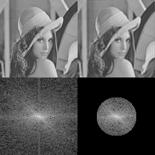

_Figure 10: Frequency-domain mask used to retain low-frequency components._

The mask retains the selected low-frequency region around the centre of the Fourier spectrum while suppressing components outside that region.

When the filtered spectrum is transformed back into the spatial domain using the IDFT, the resulting image appears smoother because some high-frequency information has been removed.

_Figure 11: Resulting image after low-pass filtering._

The filtered image demonstrates the smoothing effect produced by reducing high-frequency components. A smaller retained frequency region produces stronger smoothing because more high-frequency information is removed.

### High-Pass Filtering

A **high-pass filter** reduces low-frequency components while allowing higher-frequency components to pass.

Since high-frequency components are associated with rapid changes in intensity, high-pass filtering can emphasize edges and fine details.

An ideal high-pass filter can be represented as

$$
H(k,l)=
\begin{cases}
0, & D(k,l)\leq D_0 \
1, & D(k,l)>D_0
\end{cases}
$$

where $D_0$ is the cutoff frequency.

In a shifted Fourier spectrum, suppressing the central region therefore removes selected low-frequency components while retaining higher-frequency components.

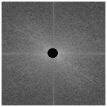

_Figure 12: Frequency-domain mask that suppresses the central low-frequency region._

The central region of the shifted Fourier spectrum corresponds to low spatial frequencies. The high-pass mask suppresses this region while retaining frequency components farther from the centre.

The filtered frequency-domain representation is then transformed back into the spatial domain using the IDFT.

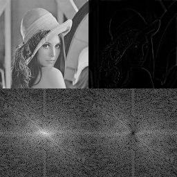

_Figure 13: Resulting image after high-pass filtering._

The resulting image emphasizes rapid intensity variations such as edges and fine details. Compared with the original image, smooth or slowly varying intensity information is reduced because the corresponding low-frequency components have been suppressed.

This demonstrates the relationship between frequency components and image appearance: removing low frequencies reduces smooth background information, while retaining higher frequencies emphasizes changes such as edges and fine details.

### Relationship Between Spatial and Frequency Domains

The spatial and frequency domains provide two complementary representations of the same image.

The spatial domain directly represents pixel intensities and their locations. The frequency domain represents the same image using spatial-frequency components.

The relationship can be summarized as

$$
\text{Spatial-domain image}
\overset{\mathrm{DFT}}{\longrightarrow}
\text{Frequency-domain representation}
$$

and

$$
\text{Frequency-domain representation}
\overset{\mathrm{IDFT}}{\longrightarrow}
\text{Spatial-domain image}
$$

This relationship makes it possible to analyse and modify an image using whichever representation is more suitable for the task.

### What to Observe in the Fourier Transform Experiment

In this experiment, observe how an image changes when it is represented in the frequency domain and how modifying frequency components affects the resulting image.

In particular, observe:

- how the spatial-domain image is represented by a frequency spectrum;
- how the DFT represents an image using discrete spatial-frequency components;
- how the magnitude and phase spectra provide different information about the image;
- how the zero-frequency or DC component is positioned at the centre after shifting the spectrum;
- how low-frequency components are concentrated near the centre of the shifted spectrum;
- how high-frequency components occur farther from the centre;
- how smooth regions, edges, and fine details contribute to different frequency components;
- how sinusoidal patterns produce identifiable frequency components;
- how logarithmic scaling makes weaker components of the Fourier spectrum easier to observe;
- how low-pass filtering suppresses higher-frequency components and produces smoothing; and
- how high-pass filtering suppresses lower-frequency components and can emphasize edges and fine details.

These observations help establish the relationship between the visual characteristics of an image and its frequency-domain representation.

### Understanding the Fourier Transform

The Fourier Transform provides an alternative representation of an image in terms of its spatial-frequency components. It represents the image as a combination of sinusoidal basis functions and provides information about the strength and phase of these components.

The DFT is the appropriate formulation for digital images because the image consists of a finite number of discrete pixel values. The magnitude spectrum provides a useful visual representation of the strength and distribution of frequency components, while the phase spectrum provides important information about their spatial organization.

Frequency-domain processing makes it possible to selectively modify particular ranges of spatial frequencies. Low-pass filtering can reduce high-frequency variations and smooth an image, while high-pass filtering can emphasize rapid intensity changes such as edges and fine details.

The key idea of the **Fourier Transform experiment** is that an image can be represented equivalently in the spatial and frequency domains. Understanding this relationship makes it possible to analyse the frequency content of an image and observe how selective modification of that content affects the resulting image.
